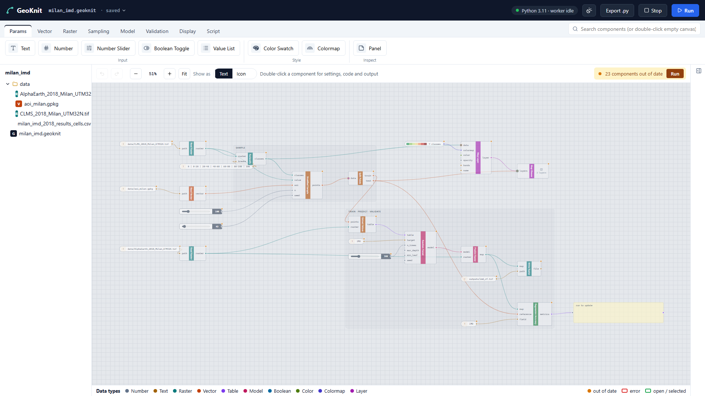
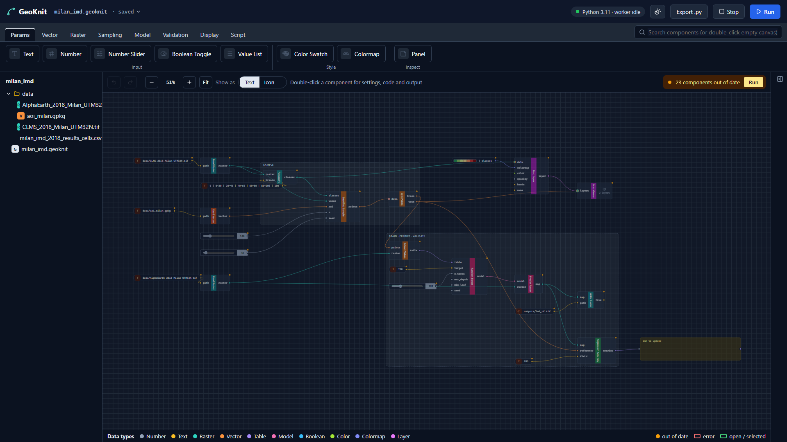

# GeoKnit

Local, open-source visual programming for geospatial analysis, in the style
of Grasshopper for Rhino. You wire small Python components (read a raster,
sample points, train a random forest, validate) on a canvas in your browser.
GeoKnit runs them on your own machine and shows the results as you go. Every
component is a short Python script you can open and edit, and a whole
workflow can be exported as one plain Python script.

<p>
  
  
</p>

The Milan imperviousness workflow in the light and dark theme (the theme follows
your system by default; the top-bar button switches it).

- **Local**: a small Python server on your computer, opened in the browser.
  Your data never leaves the machine.
- **Readable**: components are plain Python files with typed inputs and
  outputs ([writing components](https://github.com/tanxiaoo/geoknit/blob/main/docs/writing-components.md)).
- **Big rasters**: rasters stay lazy and predictions run window by window,
  so a city at 10 m with 64 bands works on a laptop.
- **Cached**: results are kept on disk; changing a setting reruns only what
  depends on it.
- **Reproducible**: **Export .py** writes the workflow as a script that gives
  the same results without GeoKnit.

Status: **0.1**, the first release. Python 3.11 or newer; tested on Windows
and Linux (macOS should work but is not tested yet).

## Install

```bash
pip install geoknit
```

A virtual environment keeps it apart from your other Python packages:

```bash
python -m venv geoknit-env
geoknit-env\Scripts\activate        # Windows
source geoknit-env/bin/activate     # macOS / Linux
pip install geoknit
geoknit --version
```

Everything comes from pip wheels (rasterio, geopandas, scikit-learn, …); you
do not need GDAL, QGIS, conda or Node. A system GDAL/PROJ installation (e.g.
from PostGIS or QGIS) does not get in the way.

## Try it on the synthetic example (5 minutes)

The examples are in this repository, not in the pip package. Download it
(GitHub → Code → Download ZIP) or clone it:

```bash
git clone https://github.com/tanxiaoo/geoknit.git
cd geoknit
python examples/synthetic/make_data.py      # small test rasters in examples/synthetic/data
geoknit examples/synthetic/imd.geoknit      # opens the browser
```

1. GeoKnit asks *"This workflow contains Python code. Trust and allow
   running?"*. A workflow that was not saved on your machine opens
   read-only until you click **Trust**.
2. Click **Run** (top right). Each component shows its state as it runs; when
   they are done, the yellow Panel on the right shows the accuracy metrics
   (n, RMSE, MAE, R², bias).
3. Change the *n_trees* slider and press **Run** again: only the model and
   what depends on it run again.
4. Double-click any component to see its settings, its code and its output.

Press Ctrl+C in the terminal to stop GeoKnit.

## The Milan example

[docs/milan-walkthrough.md](https://github.com/tanxiaoo/geoknit/blob/main/docs/milan-walkthrough.md) goes through the real
workflow: map imperviousness over Milan from AlphaEarth embeddings, trained
and validated on CLMS IMD 2018. It needs three data files that you copy into
`examples/milan_imd/data/` ([which files](https://github.com/tanxiaoo/geoknit/blob/main/examples/milan_imd/README.md)).

## Using GeoKnit

| Want to… | Do |
|----------|----|
| start on a folder | `geoknit my-project` (the current folder by default), then *File → Save as…* |
| add a component | pick it in the ribbon, or double-click empty canvas and type |
| use a file | drag it from the folder tree on the left onto the canvas |
| connect | drag from an output (right side) to an input (left side); colours show the type |
| see a result | wire it into a **Panel** (Params tab), or hover an output |
| see a map | wire rasters and vectors into a **Map Viewer** (Display tab) and double-click it; a **Map Layer** with a **Colormap** styles one layer |
| change code | double-click a component → **Code**; **Test** runs just that one |
| keep a component | in its window, **Save as component…** (it appears in the ribbon) |
| run without the browser | `geoknit run my-workflow.geoknit` (prints every Panel) |
| get a Python script | **Export .py**, or `geoknit export my-workflow.geoknit` |

`geoknit --help`, `geoknit run --help` and `geoknit export --help` list the
options. The server only listens on your own computer (127.0.0.1); its API is
documented at `/docs` while it runs.

## Documentation

- [Milan walkthrough](https://github.com/tanxiaoo/geoknit/blob/main/docs/milan-walkthrough.md): the reference workflow, step by step
- [Writing components](https://github.com/tanxiaoo/geoknit/blob/main/docs/writing-components.md): the component file format, with examples
- [Design spec](https://github.com/tanxiaoo/geoknit/blob/main/docs/SPEC.md): how everything behaves, in detail
- [Releasing](https://github.com/tanxiaoo/geoknit/blob/main/docs/releasing.md): how a new version is published

## Developing GeoKnit

```bash
pip install -e ".[dev]"
pytest
ruff check . && ruff format .

cd frontend
npm install
npm run dev        # Vite dev server on :5173, proxies /api to a backend on :8000
npm test
npm run build      # into geoknit/server/static, served by `geoknit`
```

Run a backend for the dev server with `geoknit examples/synthetic --port 8000 --no-browser`.
[CLAUDE.md](https://github.com/tanxiaoo/geoknit/blob/main/CLAUDE.md) describes the repository layout and rules;
[PLAN.md](https://github.com/tanxiaoo/geoknit/blob/main/PLAN.md) tracks progress.

## License

Apache-2.0, see [LICENSE](https://github.com/tanxiaoo/geoknit/blob/main/LICENSE).
