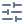

# Icons

<!-- Generated by frontend/src/icons/registry.test.tsx. Do not edit: run
     `UPDATE_ICONS=1 npx vitest run src/icons` in frontend/ to rewrite it. -->

Names a component header can use in `icon:` (see
[writing-components.md](writing-components.md)). A name that is not in this
list falls back to the category's icon. For any other icon, ship an `.svg`
file with the component and name its path relative to the component file:
`icon: icons/my-icon.svg` (it must stay inside the pack folder). Icons are
drawn in one colour (`currentColor`), so they follow the theme.

Sets, in the order GeoKnit chooses from them: [Font-GIS](https://github.com/Viglino/font-gis)
(icons CC BY 4.0, Jean-Marc Viglino), [Lucide](https://lucide.dev) (ISC),
[Tabler Icons](https://tabler.io/icons) (MIT). See `THIRD_PARTY_NOTICES.md`.

| Icon | Name | Set |
|------|------|-----|
|  | `gis:color` | Font-GIS (CC BY 4.0) |
|  | `gis:layer-download` | Font-GIS (CC BY 4.0) |
|  | `gis:layers` | Font-GIS (CC BY 4.0) |
|  | `gis:layers-poi` | Font-GIS (CC BY 4.0) |
|  | `gis:map` | Font-GIS (CC BY 4.0) |
|  | `gis:map-legend` | Font-GIS (CC BY 4.0) |
|  | `gis:mosaic` | Font-GIS (CC BY 4.0) |
|  | `gis:multipoint` | Font-GIS (CC BY 4.0) |
|  | `gis:poi-info` | Font-GIS (CC BY 4.0) |
|  | `gis:polygon-pt` | Font-GIS (CC BY 4.0) |
|  | `gis:proj-geo` | Font-GIS (CC BY 4.0) |
|  | `gis:select-extent` | Font-GIS (CC BY 4.0) |
|  | `gis:snap` | Font-GIS (CC BY 4.0) |
|  | `gis:split` | Font-GIS (CC BY 4.0) |
|  | `lucide:calculator` | Lucide (ISC) |
|  | `lucide:code` | Lucide (ISC) |
|  | `lucide:grid-2x2-check` | Lucide (ISC) |
|  | `lucide:hash` | Lucide (ISC) |
|  | `lucide:list` | Lucide (ISC) |
|  | `lucide:rainbow` | Lucide (ISC) |
|  | `lucide:sigma` | Lucide (ISC) |
|  | `lucide:sliders-horizontal` | Lucide (ISC) |
|  | `lucide:sticky-note` | Lucide (ISC) |
|  | `lucide:sun-moon` | Lucide (ISC) |
|  | `lucide:table` | Lucide (ISC) |
|  | `lucide:target` | Lucide (ISC) |
|  | `lucide:toggle-right` | Lucide (ISC) |
|  | `lucide:trees` | Lucide (ISC) |
|  | `lucide:type` | Lucide (ISC) |
|  | `lucide:wand-sparkles` | Lucide (ISC) |
|  | `tabler:brand-python` | Tabler Icons (MIT) |
