# Walkthrough: imperviousness of Milan

This walkthrough runs GeoKnit's reference workflow from start to finish. It
maps the imperviousness of Milan (the share of sealed soil, 0–100 %) at 10 m
from AlphaEarth satellite embeddings, trains a random forest on the Copernicus
CLMS Imperviousness Density 2018 layer, and checks the map on points the model
never saw.

You will open the workflow, run it, read the accuracy, look inside a
component, see the map, change a setting, and export everything as a Python
script. It takes about 15 minutes.

## Before you start

- GeoKnit installed (`pip install geoknit`, see the [README](../README.md)),
  and this repository downloaded or cloned (the example lives in it).
- The three data files copied into `examples/milan_imd/data/`. The
  [example's README](../examples/milan_imd/README.md) lists them, with the
  CRS and band names they need:
  - `CLMS_2018_Milan_UTM32N.tif`: CLMS IMD 2018, 1 band, in %;
  - `aoi_milan.gpkg`: the area of interest, one polygon;
  - `AlphaEarth_2018_Milan_UTM32N.tif`: 64 embedding bands `A00`…`A63`.

## 1. Open the workflow

From the repository folder:

```bash
geoknit examples/milan_imd/milan_imd.geoknit
```

GeoKnit starts on your computer and opens the workflow in the browser. The
first time, it asks *"This workflow contains Python code. Trust and allow
running?"*: a workflow file you did not save yourself could run any code, so
it opens read-only until you click **Trust**.

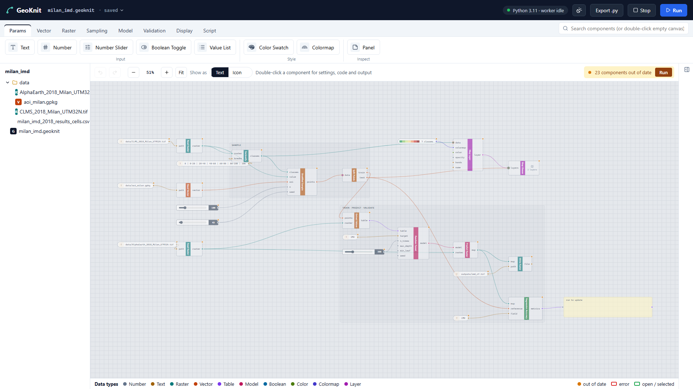

- **Top bar**: the file name and whether it is saved, the worker (the Python
  process that runs components), **Export .py**, **Stop** and **Run**.
- **Ribbon**: the components by category (Params, Vector, Raster, Sampling,
  Model, Validation, Display, Script), and a search box.
- **Folder tree** (left): the project folder. Drag a file onto the canvas to
  get a Text node with its path.
- **Canvas**: the workflow. Data flows from left to right, from an output on
  the right of a node to an input on the left of the next. Wire colours show
  the type: teal Raster, orange Vector, purple Table, pink Model, brown Text,
  grey Number, indigo Colormap, magenta Layer. The legend at the bottom lists
  them all.

The banner says *23 components out of date*: nothing has run yet. (The Map
Layer and the Map Viewer are not counted: they only show results, see
section 4.)

### Reading it left to right

| Nodes | What they do |
|-------|--------------|
| Text `data/CLMS_…tif` → **Read Raster** | opens the CLMS layer (lazily: nothing is read yet) |
| Text with breaks → **Reclassify** | turns IMD % into 7 classes: `0 \| 0-20 \| 20-40 \| 40-60 \| 60-80 \| 80-100 \| 100` (`a-b` means a < x ≤ b) |
| Text `data/aoi_milan.gpkg` → **Read Vector** | the area of interest |
| **Stratified Sample** (sliders *n* = 100, *seed* = 42) | 100 random pixels per class inside the AOI, each storing its CLMS value in the field `IMD` |
| **Split Points** | keeps 30 % of the points (stratified by class) as *test* points; the rest are *train* points |
| Text `data/AlphaEarth_…tif` → **Read Raster** | the 64-band embeddings |
| **Extract Values** | the 64 band values at each training point → a table |
| **Random Forest** (slider *n_trees* = 300, target `IMD`) | learns IMD from the 64 bands |
| **Predict Raster** | applies the model to every pixel, 512 × 512 px at a time |
| **Write Raster** → `outputs/imd_rf.tif` | saves the predicted map as a Cloud Optimized GeoTIFF |
| **Regression Accuracy** → Panel | compares the map with the test points' `IMD` |
| **Colormap** (7 classes) → **Map Layer** "IMD classes" → **Map Viewer** | draws Reclassify's classes with a colour and a label each, and the test points, on a map |

The grey boxes (*Sample*, *Train · predict · validate*) are groups: they only
help reading.

## 2. Run it

Click **Run**. Each node shows its state while it works; the first run takes
about a minute on a laptop, most of it predicting 64 bands over the city.

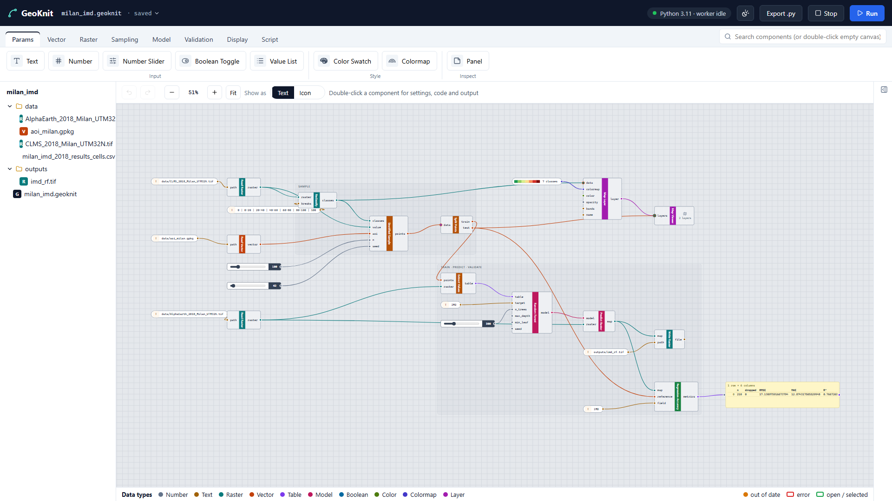

The yellow **Panel** shows the accuracy table:

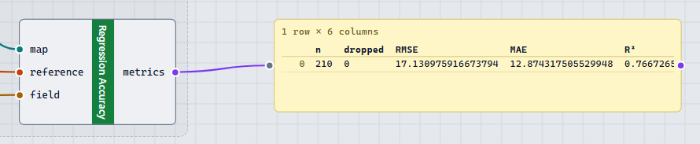

| | |
|-|-|
| `n` | 210 test points used |
| `dropped` | test points outside the map or on nodata (none here) |
| `RMSE` | 17.1 percentage points, root mean squared error |
| `MAE` | 12.9 points, mean absolute error |
| `R²` | 0.77 |
| `bias` | +0.6 points (observed − predicted, on average) |

Your numbers can differ slightly if your data files differ; with the same
files and seeds they are the same on every run and every machine.

Every result is now in the cache (`examples/milan_imd/.geoknit/cache/`). Press
**Run** again: nothing runs, everything is *cached*.

## 3. Look inside a component

Double-click **Random Forest**.

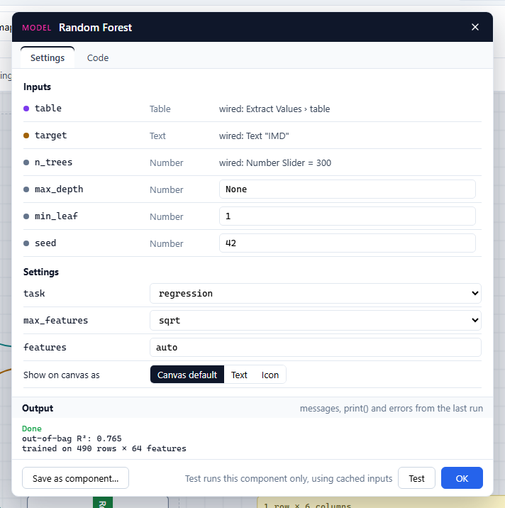

- **Inputs** shows what each input receives. `n_trees` is wired to the
  slider; `max_depth`, `min_leaf` and `seed` are not wired, so the values in
  their fields are used.
- **Settings** are the component's options: here the task (regression or
  classification), `max_features` and which columns to use as features.
- **Output** shows what the component printed in the last run: the
  out-of-bag R² (an internal estimate, 0.765 here) and that it trained on
  490 rows × 64 features (the 70 % of 700 points that are not test points).

Click **Code**:

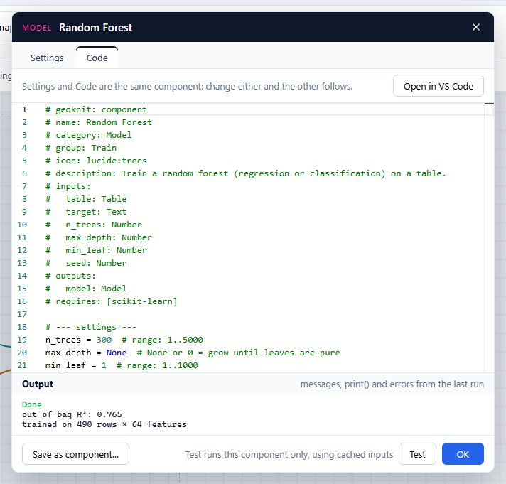

This is the whole component: a header declaring its inputs and outputs, the
settings block (the same values as the Settings tab; editing one updates the
other), and plain Python using scikit-learn. You can change it here: **Test**
runs only this component with its cached inputs, and **OK** keeps the change.
An edited built-in is stored inside the workflow and marked *modified*;
the library stays untouched. [Writing components](writing-components.md)
explains the format.

Close the window with **OK** or ×.

## 4. See the map

The top right of the canvas holds the map part of the workflow:

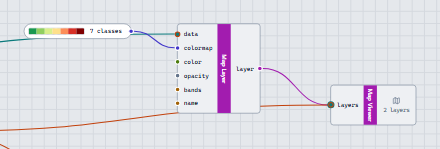

- **Colormap** (ribbon: Params › Style) holds the 7 IMD classes, each with a
  colour and a label. Double-click it to edit them:

  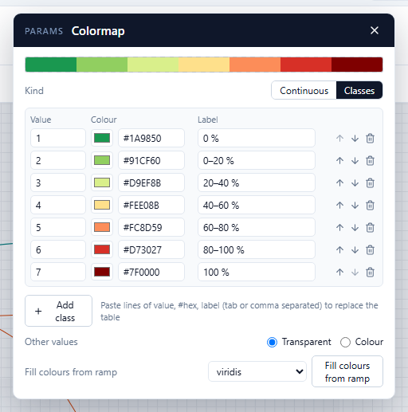

  *Classes* lists value, colour and label; *Continuous* is a ramp with a min
  and max instead. Pasting lines of `value, #hex, label` replaces the table,
  so a legend kept in a spreadsheet comes in at once.
- **Map Layer** "IMD classes" (ribbon: Display › Style) styles one layer:
  Reclassify's classes in `data`, the Colormap in `colormap`. Opacity, bands,
  colour and name are set in its window (double-click) or wired in.
- **Map Viewer** (Display › Map) shows every layer wired into `layers`: here
  the Map Layer and, unstyled, **Split Points**' `test` points.

Map Layer and Map Viewer never need a Run: they are ready as soon as the
data they show is. Double-click the Map Viewer:

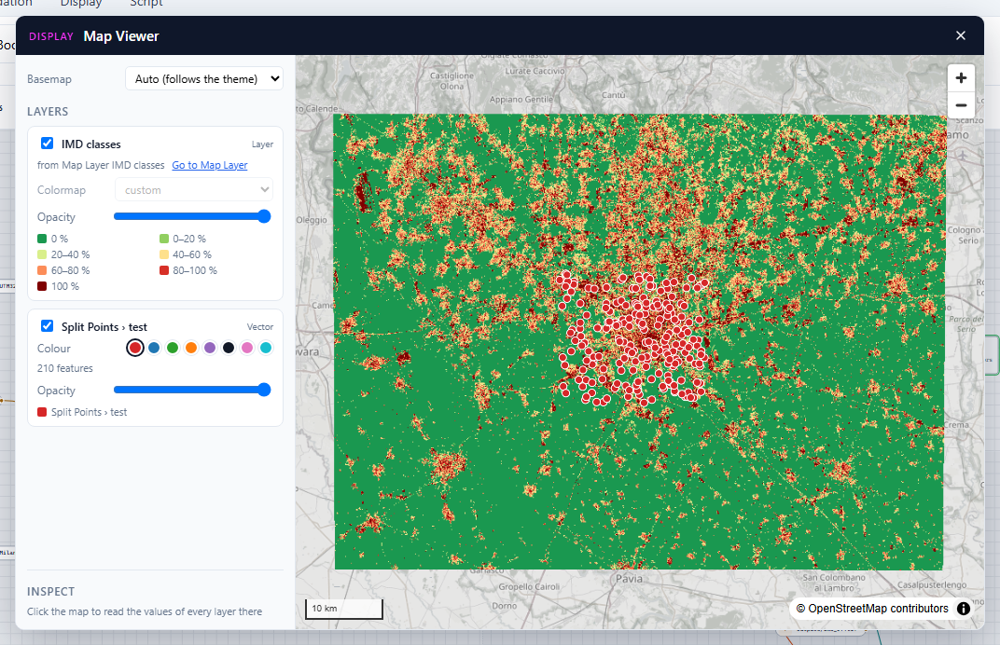

The CLMS classes are drawn over OpenStreetMap with the 210 test points on
top, and the legend shows the class labels. The style of *IMD classes*
comes from the Map Layer, so its controls are read-only here (*Go to Map
Layer* selects the node). Change a colour in the Colormap editor and the
open map redraws at once, without running anything. Click the map to read
the values of every layer at that point.

To see the prediction too, wire **Predict Raster**'s `map` output into the
same `layers` input (it takes several wires; the first one is drawn on
top). Untick *IMD classes* to look underneath:

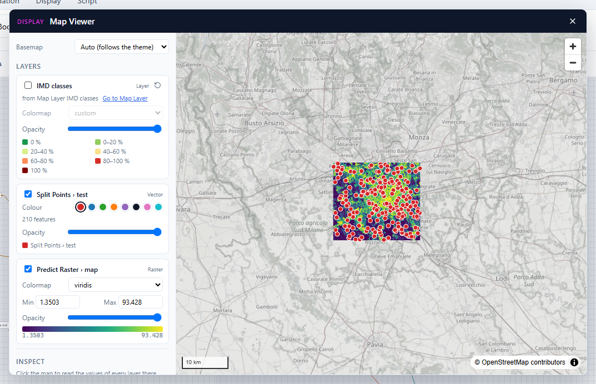

A raw wire like this one is styled in the viewer itself: colormap, the min
and max of the stretch, the band and the opacity; these styles are saved
with the workflow. Tiles come from the cached Cloud Optimized GeoTIFF and its
overviews, so panning and zooming stay quick at city scale. With the theme
set to dark, the basemap (*Auto*) follows it:

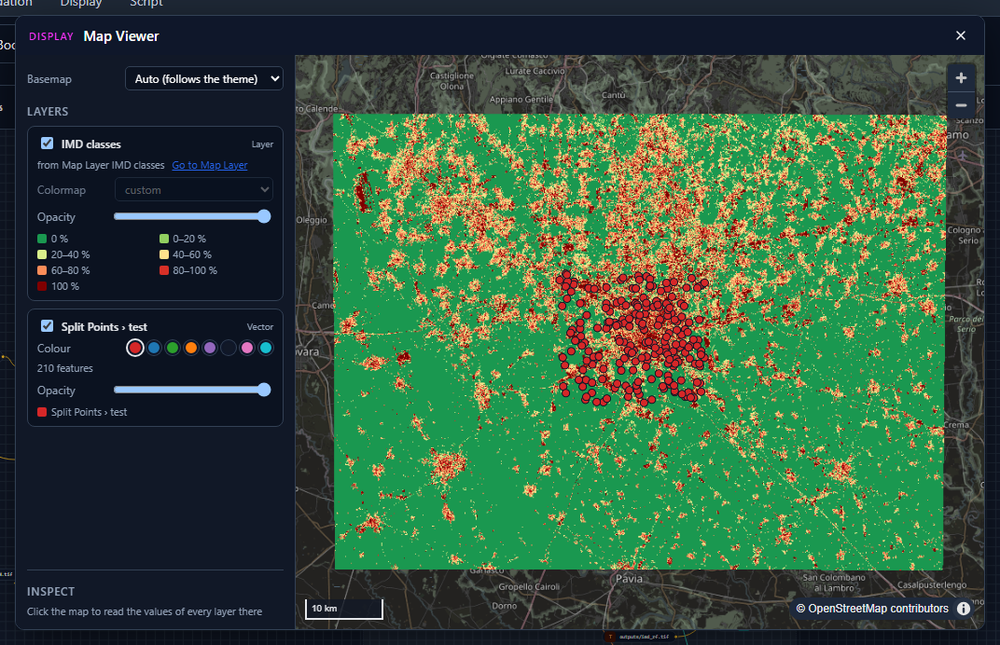

## 5. Change something

Try a different model size: drag the **n_trees** slider to 100 and press
**Run**. Only Random Forest and what depends on it (Predict Raster, Write
Raster, Regression Accuracy) run again; reading the rasters and sampling come
from the cache, and the Map Viewer redraws the new prediction. The banner
always tells you how many components are out of date.

Other things worth trying:

| Change | Where |
|--------|-------|
| points per class | the *n* slider (100) |
| a different random sample | the *seed* slider (42) |
| class breaks | the Text node with `0 \| 0-20 \| …` (then the Colormap's classes too) |
| class colours and labels | double-click the Colormap |
| share of test points | Split Points' `test_fraction` (0.3) |
| a different model | add **SVM** from the Model tab, wire it like Random Forest, and give it its own Predict Raster and Regression Accuracy |

Save with Ctrl+S (or the file name menu → *Save*). Unsaved changes are also
autosaved: if GeoKnit is closed by accident, it offers to restore them next
time.

## 6. Export as a Python script

Click **Export .py**:

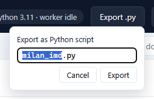

The script is written next to the workflow (`milan_imd.py`), because the
data paths in it are relative to that folder. Run it with plain Python:

```bash
python examples/milan_imd/milan_imd.py
```

It prints the same metrics Panel as GeoKnit. Inside, the Text and slider
values are constants at the top (`N07_N = 100`, `N15_N_TREES = 300`), each
component is a function containing its settings and code, and `main()` calls
them in order. The Colormap is a constant too; the Map Layer and the Map
Viewer only show results, so they are comments
(`# n24 Map Layer "IMD classes": n04.classes, colormap n23`). It needs the same packages as GeoKnit but not GeoKnit itself,
so you can share it, put it on a server, or keep it with a paper.

The same from the command line:

```bash
geoknit export examples/milan_imd/milan_imd.geoknit     # writes milan_imd.py
```

## 7. Run without the browser

```bash
geoknit run examples/milan_imd/milan_imd.geoknit
```

runs the workflow headless and prints each Panel. It uses the same cache as
the canvas, so after a run in the browser it finishes at once. `--no-cache`
ignores the cache; `-q` hides the components' messages.

## Where next

- [Writing components](writing-components.md): make your own, or a pack for
  others.
- [The design spec](SPEC.md): how GeoKnit behaves, in detail.
- The synthetic example (`examples/synthetic/`) is the same workflow on small
  generated rasters, for trying things without the Milan data.

The screenshots in this page are made by `frontend/docs-shots/` on the real
data: `cd frontend && npm run build && npm run screenshots`.
